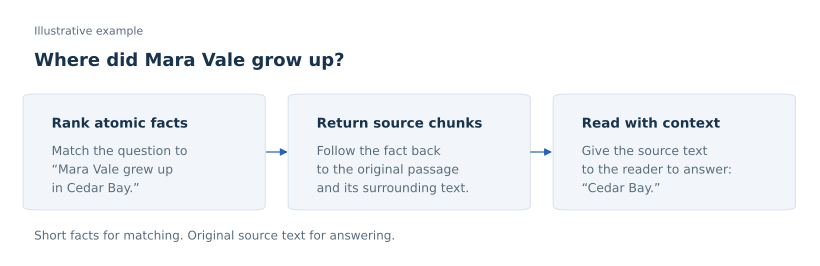
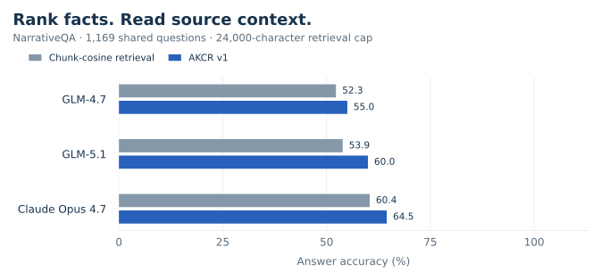

<div align="center">
  <a href="https://icml.cc/Conferences/2026"></a>
  <h1>Atom-Keyed Chunk Retrieval</h1>
  <p><strong>Find the fact. Read the original passage.</strong></p>
  <a href="https://icml.cc/Conferences/2026"></a>
  <p>A research pipeline for question answering over long documents.</p>
  <p><a href="#how-it-works">How it works</a> · <a href="#results">Results</a> · <a href="#run-a-small-evaluation">Get started</a> · <a href="#repository-guide">Code guide</a></p>
</div>

---

When a question concerns one detail in a whole book or report, sending the entire
document to an LLM can be expensive. **AKCR searches short facts, then gives the
reader their original source passages** within a fixed context budget.

> **Illustrative example**<br>
> **Question:** Where did Mara Vale grow up?<br>
> **Fact used for ranking:** Mara Vale grew up in Cedar Bay.<br>
> **Source paragraph sent to the reader:** “Mara Vale spent her childhood in
> Cedar Bay, where her family lived near the harbor. She moved away at nineteen.”

The short fact helps locate the answer; the source paragraph preserves the
surrounding context. This example illustrates the mechanism, rather than a
prediction from the benchmark.

## How it works

<p align="center"></p>

1. **Prepare the document.** Split it into chunks; extract and embed short atomic
   propositions (short Davidsonian facts), keeping each fact's source-chunk ID.
2. **Search the facts.** Rank atom embeddings by cosine similarity to the question.
3. **Return to the source.** Follow the deterministic `atom → source-chunk` map.
4. **Read within budget.** Pack the selected chunks, restore document order, and
   ask the reader LLM to answer from those passages.

**The central idea: rank on a different unit than you read from.** Atoms are the
ranking unit; chunks are the reading unit.

## Results

**Fixed AKCR v1 improves over chunk-cosine retrieval across three readers** in the
released NarrativeQA full-book evaluation: **40 stories, 1,169 evaluated questions,
24,000-character retrieval cap, GLM-4.7 judge**. Accuracy is the fraction of
answers the judge accepted against either reference answer.

<p align="center"></p>

| Reader | Chunk-cosine baseline | AKCR v1 | Gain |
|---|---:|---:|---:|
| GLM-4.7 | [611 / 1,169 · 52.27%](results/full_book_dosrag_chunks_e2e_b24000.summary.json) | [643 / 1,169 · 55.00%](results/full_book_akcr_v010_glm47_b24000.summary.json) | +32 correct · **+2.74 pp** |
| GLM-5.1 | [630 / 1,169 · 53.89%](results/full_book_dosrag_chunks_glm-5.1_b24000.summary.json) | [701 / 1,169 · 59.97%](results/full_book_akcr_v010_glm51_b24000.summary.json) | +71 correct · **+6.07 pp** |
| Opus-4.7 | [706 / 1,169 · 60.39%](results/full_book_dosrag_chunks_claude-opus-4-7_b24000.summary.json) | [754 / 1,169 · 64.50%](results/full_book_akcr_v010_opus_b24000.summary.json) | +48 correct · **+4.11 pp** |

Each cell links to its released summary; matching per-question `.jsonl` files are
in [results/](results/). The chart and table use the original fixed v1 runs at
[frozen source commit `78e0ae0`](https://github.com/ArthurQQQQ/atom-keyed-chunk-retrieval-qa-ICMLW/tree/78e0ae008239ad885295d54440f6198c6855e110).
HACS, MAR, and repeated-run results are reported separately.

## What you can do

| Goal | Start here |
|---|---|
| Inspect the released evidence without running an API | [Results above](#results) and [per-question outputs](results/) |
| Evaluate fixed v1 on prepared NarrativeQA inputs | [Small evaluation below](#run-a-small-evaluation) |
| Compare atom-best, aggregated-atom, and hybrid ranking | [Scoring variants](#scoring-variants) in `scripts/eval_akcr_v2.py` |
| Explore baselines, reader prompts, and significance tools | [Repository guide](#repository-guide) |

## Run a small evaluation

This repository ships **evaluation scripts and released results**. Before running
them, prepare the NarrativeQA source text, V010 atoms, chunks, QA records, and
BGE-M3 embeddings. Source documents, preprocessing tools, and embedding files
are not bundled in this checkout.

### 1. Prepare the inputs

The main entry point, [`scripts/eval_akcr_v2.py`](scripts/eval_akcr_v2.py), expects:

```text
<prepared-data-root>/
├── data/narrativeqa/processed_v010_full/
│   ├── nodes_v010_full_book.jsonl
│   ├── chunks_full.jsonl
│   └── qa_full.jsonl
└── data/embeddings/full_book/
    ├── nodes.npy
    ├── chunks.npy
    └── queries.npy
```

Atoms and chunks need matching `story_id` and `chunk_index` fields; chunks also
need `text`. QA records use `story_id`, `qa_idx`, `question`, `answer1`, and
`answer2`. Atom/chunk embedding rows must follow their JSONL order; `qa_idx`
indexes the query-embedding matrix. All three matrices must share an embedding
space.

Place this layout in the repository, or set `MEMORYNET_REPO` to its root. The
script checks repository data first, then `MEMORYNET_REPO`, then `~/MemoryNet`,
using the presence of `qa_full.jsonl` to choose a root. Its input paths are fixed
relative to that root.

### 2. Install and configure the API

```bash
git clone https://github.com/ArthurQQQQ/atom-keyed-chunk-retrieval-qa-ICMLW.git
cd atom-keyed-chunk-retrieval-qa-ICMLW
python -m venv .venv
source .venv/bin/activate
python -m pip install -r requirements.txt
```

Set `GLM_URL` and `GLM_API_KEY` using [`.env.example`](.env.example). You can
export them in your shell or put a `.env` / `.env.local` in the **chosen data
root**. `GLM_URL` is a chat-completions URL. The script uses this endpoint for GLM
and Claude gateway model names; GPT/OpenAI names use `OPENAI_URL` and
`OPENAI_API_KEY` instead. Both reader and judge make API calls.

### 3. Evaluate three questions

After the inputs and credentials are ready, run from the repository root:

```bash
python scripts/eval_akcr_v2.py \
  --method v1 \
  --reader-model glm-4.7 \
  --judge-model glm-4.7 \
  --char-budget 24000 \
  --max-questions 3 \
  --concurrency 1 \
  --out results/my_smoke.jsonl \
  --summary-out results/my_smoke.summary.json
```

Inspect the predictions and summary, including `n_total` (completed evaluations)
and `n_yes` (accepted answers). Remove `--max-questions 3` for a full run.
`--char-budget` controls characters, `--K-atoms` controls the candidate-atom pool
(default 200), and `--concurrency` controls concurrent evaluations.

## Scoring variants

The main entry point supports four variants using the same embeddings, packing,
reader prompt, and judge. They change how a chunk receives its score; HACS also
allows chunks outside the top-atom candidate pool to enter through chunk cosine.

| `--method` | Chunk score |
|---|---|
| `v1` | Best atom score; each source chunk is selected once |
| `mar_sum` | Sum of scores from the chunk's atoms in the top-K atom pool |
| `mar_lse` | Log-sum-exp of those atom scores (`--tau`, default 5.0) |
| `hacs` | `alpha · atom-best + (1 − alpha) · chunk-cosine` (`--alpha`, default 0.7) |

## Research context

This repository accompanies **“Tokenization Beats Propagation: A Position on
Graph Foundation Models for LLM Retrieval Interfaces”** (GFM @ ICML 2026
workshop). The paper argues that the retrieval representation itself is a
central design choice: rank on atoms and read source chunks, without graph
propagation. The table above compares this interface against chunk-cosine retrieval.

The original analysis also asks how much of the gap to a **same-reader
long-context oracle** AKCR closes at a fixed retrieval budget. For GLM-4.7, the
[full-book reference](results/long_context_oracle_full_book.summary.json) accepts
754 / 1,169 answers: v1 closes 32 of the baseline's 143-answer gap (22.4%). Oracle
results must be interpreted per reader and cohort: the released
[GLM-5.1 reference](results/long_context_oracle_full_book_glm51.summary.json) has
1,169 evaluations and the [Opus reference](results/long_context_oracle_full_book_opus.summary.json)
has 149. They are separate from the equal-budget comparison above.

## Repository guide

```text
scripts/   Evaluation pipelines, baselines, table and significance tools
results/   Released per-question predictions, summaries, and research plots
assets/    README overview and result graphics
```

| Script | Purpose |
|---|---|
| [`eval_akcr_v2.py`](scripts/eval_akcr_v2.py) | Main reader evaluation: v1 / mar_sum / mar_lse / hacs |
| [`eval_akcr_e2e.py`](scripts/eval_akcr_e2e.py) | Original end-to-end AKCR v1 with explicit input-path flags |
| [`eval_akcr_acrp.py`](scripts/eval_akcr_acrp.py) | Atom-Conditioned Reader Prompt variant |
| [`eval_akcr_v2_permissive.py`](scripts/eval_akcr_v2_permissive.py) | Permissive-matching ablation |
| [`eval_dosrag_chunks_reader_sweep.py`](scripts/eval_dosrag_chunks_reader_sweep.py) | Chunk-cosine baseline (`DOS+chunks`) |
| [`eval_gar_e2e.py`](scripts/eval_gar_e2e.py) | Atoms-as-content baseline (GAR) |
| [`compile_v2_table.py`](scripts/compile_v2_table.py), [`compile_wave1_table.py`](scripts/compile_wave1_table.py) | Tables from released result files; review each tool's cohort and rerun filters |
| [`compare_v2_to_v1.py`](scripts/compare_v2_to_v1.py), [`significance_test.py`](scripts/significance_test.py) | Paired-bootstrap comparisons |
| [`run_v2_sequential.sh`](scripts/run_v2_sequential.sh), [`run_acrp_and_variance.sh`](scripts/run_acrp_and_variance.sh) | Batch runners |

Original result files use `full_book_{method}_{reader}_b{budget}.jsonl` with a
matching `.summary.json`; v2 ablations and reruns use their own descriptive names.
